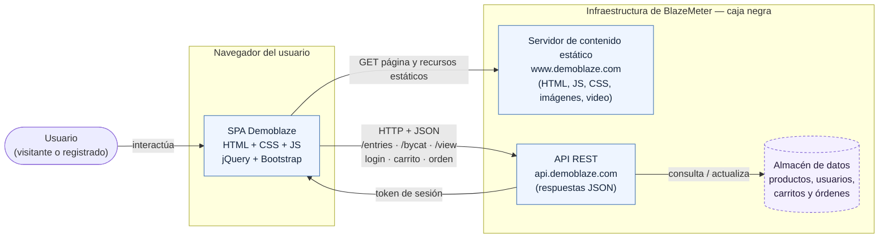

# Proyecto del Curso — Entrega I

**Construcción de Software y Pruebas · Grupo A · 2026-2**
**Pontificia Universidad Javeriana Cali · Profesora: Claudia Martínez**
**Entrega I (100 pts) · Fecha de entrega: 22 de octubre de 2026**

> **Nota preliminar sobre el sistema bajo prueba.** Demoblaze es un sitio de
> terceros publicado por BlazeMeter. El equipo no tiene su código fuente ni acceso
> al servidor, a la base de datos o a los registros de aplicación: solo lo prueba
> por caja negra desde el navegador. Por eso, las secciones que describen cómo está
> construido el sistema (en especial la arquitectura) se basan en lo que se observa
> desde afuera —el tráfico HTTP y los recursos que carga el navegador— y no en
> documentación interna del proveedor.

---

## 1. Información general

| Elemento | Detalle |
|---|---|
| **Nombre del software** | Demoblaze |
| **Tipo de sistema** | Comercio electrónico: tienda en línea de demostración (demo e-commerce) |
| **URL de la aplicación** | https://www.demoblaze.com |
| **API que consume** | https://api.demoblaze.com |
| **Proveedor** | BlazeMeter |
| **Curso** | Construcción de Software y Pruebas — Grupo A — 2026-2 |
| **Profesora** | Claudia Martínez |
| **Institución** | Pontificia Universidad Javeriana Cali |

### Integrantes del equipo

| Integrante | Rol en la entrega |
|---|---|
| Joshua Mendez | Integrante |
| Edinson Pedroza | Integrante |

### Repositorio del código

Aquí hay que hacer una distinción, porque el sistema bajo prueba no es del equipo.

- **Código fuente de Demoblaze (el SUT): no disponible.** Demoblaze es un sitio de
  demostración de BlazeMeter, pensado para practicar automatización y QA. Su código
  fuente no es público y el equipo no tiene acceso al repositorio del proveedor, al
  servidor ni a la base de datos. Todo el trabajo se hace por caja negra desde el
  navegador. No se referencia ninguna URL de repositorio de Demoblaze porque no
  existe una pública que corresponda a este sistema.

- **Repositorio del equipo (artefactos de prueba): sí existe.** Lo que el equipo sí
  versiona es su propio trabajo: la suite de casos de prueba, el plan de pruebas, el
  registro de ejecución, los reportes de defectos y las evidencias. Ese es el
  repositorio que acompaña esta entrega.

| Elemento | Valor |
|---|---|
| **Repositorio del equipo (artefactos de prueba)** | `<completar: URL del repositorio del equipo>` |
| **Contenido del repositorio** | Suite de 60 casos de prueba, plan de pruebas, registro de ejecución, reportes de defectos y evidencias gráficas |

> Dejar completada la URL del repositorio del equipo antes de entregar. El
> repositorio contiene los artefactos de pruebas, no el código de Demoblaze.

---

## 2. Descripción del sistema

**Qué es.** Demoblaze es una tienda en línea de demostración: reproduce el
comportamiento de un comercio electrónico real —catálogo de productos, detalle de
producto, carrito, registro, inicio de sesión y orden de compra— pero sin vender
nada de verdad ni cobrar pagos reales. Es un entorno de práctica estable y de acceso
libre.

**Qué problema resuelve.** No resuelve un problema comercial; resuelve un problema de
formación y de herramientas. Quien aprende o ejercita pruebas de software necesita un
sistema realista contra el cual trabajar, que tenga flujos completos (navegar,
agregar al carrito, autenticarse, comprar) y que no imponga el riesgo de operar sobre
un sistema productivo real con datos o dinero de clientes. Demoblaze ofrece
exactamente eso: un e-commerce funcional, público y gratuito, que sirve de banco de
pruebas para diseñar casos, automatizar flujos y validar técnicas de testing.

**Quiénes lo usan.** Sus usuarios no son compradores reales, sino personas que
practican o enseñan calidad de software: estudiantes de pruebas, ingenieros de QA que
ensayan herramientas de automatización (Selenium, Playwright, Katalon y similares),
instructores que necesitan un sistema de ejemplo y equipos que evalúan frameworks de
prueba. Para el presente proyecto, el equipo lo usa como sistema bajo prueba de la
asignatura.

**Qué valor ofrece.** Un ambiente de práctica fiel a un comercio electrónico real,
disponible sin costo y sin necesidad de montar infraestructura propia. Al imitar los
módulos y las reglas de negocio de una tienda —el total es la suma de los ítems del
carrito, no se compra con el carrito vacío, el precio del listado coincide con el del
detalle— permite ejercitar pruebas funcionales, de integración de interfaz con
servicio, de seguridad básica y de rendimiento sobre un objetivo representativo. Que
sea un sistema de terceros, en producción y sin posibilidad de corregir sus defectos,
es parte de lo que lo hace un buen ejercicio: obliga a probar y documentar la calidad
observable desde afuera, que es la situación habitual cuando se audita un producto que
uno no construyó.

---

## 3. Arquitectura general

La arquitectura que se describe aquí es la **inferida a partir de lo observable desde
el exterior**: el tráfico HTTP del navegador, los recursos que la página carga y las
respuestas del servicio. Al no tener acceso al código ni a la infraestructura del
proveedor, no se documenta la implementación interna (lenguaje del servidor, motor de
base de datos, despliegue), sino la forma en que el cliente y el servicio se
comunican tal como se ve desde el navegador.

### 3.1 Tecnologías observadas

- **Cliente web (frontend).** Es una aplicación de página única (SPA) servida como
  contenido estático desde `www.demoblaze.com`. Está construida con HTML, CSS y
  JavaScript, apoyada en **jQuery** para la manipulación del DOM y las llamadas al
  servicio, y en **Bootstrap** para la maquetación y los componentes visuales
  (grilla, modales, carrusel). La interfaz no calcula la lógica de negocio por su
  cuenta: delega en el servicio HTTP y pinta lo que este responde.

- **Servicio (backend).** Una **API HTTP de estilo REST** en `api.demoblaze.com` que
  responde en **JSON**. El frontend la consume para listar productos, filtrar por
  categoría, cargar el detalle de un producto, autenticar y operar el carrito y la
  orden. Entre las llamadas observadas en el tráfico están `GET /entries` (listado de
  productos), `POST /bycat` (productos por categoría), `POST /view` (detalle por
  identificador) y el servicio de `login`. Las operaciones de carrito y de compra
  también pasan por esta API.

- **Autenticación por token.** El inicio de sesión se resuelve contra el servicio:
  ante credenciales válidas, la API devuelve un **token de sesión** que el cliente
  usa para las operaciones que requieren usuario autenticado. (En el tráfico del
  login se observó, además, que la contraseña viaja codificada en base64 sobre
  HTTPS; esto es un hallazgo de seguridad documentado en el plan de pruebas, no una
  característica de diseño recomendable.)

- **Almacén de datos.** No es accesible ni inspeccionable, pero su existencia se
  infiere de que la API mantiene y devuelve de forma consistente los productos,
  categorías, usuarios registrados, el contenido del carrito y las órdenes. Se
  representa como un componente lógico "almacén de datos" detrás de la API.

### 3.2 Componentes principales

1. **Cliente web (SPA).** El navegador del usuario carga la página y sus recursos
   estáticos (HTML, JS, CSS, imágenes y el video de *About us*) y ejecuta la lógica
   de presentación.
2. **API REST.** Recibe las peticiones HTTP del cliente, devuelve JSON y concentra la
   lógica de negocio (catálogo, carrito, autenticación, compra).
3. **Almacén de datos.** Guarda y provee la información que la API expone.

La separación es nítida: el cliente es "tonto" respecto del negocio y el servicio es
quien decide. Esto quedó en evidencia durante las pruebas de integración, donde la
interfaz mostró `undefined` al confiar en una respuesta `200 OK` que en realidad
traía `{"errorMessage":"Not found."}` para un producto inexistente —es decir, el
cliente pinta lo que el servicio le entrega sin validarlo por su cuenta.

### 3.3 Diagrama de arquitectura

### 3.4 Descripción del diagrama (en prosa)

El flujo va de izquierda a derecha. El **usuario** —sea visitante sin sesión o
usuario registrado— interactúa con la **SPA de Demoblaze** que se ejecuta en su
propio navegador. Esa aplicación de página única es HTML, CSS y JavaScript con jQuery
y Bootstrap, y se descarga como contenido estático desde `www.demoblaze.com` (flecha
de recursos estáticos hacia el *servidor de contenido estático*).

Toda la lógica de negocio ocurre en el segundo salto: la SPA hace peticiones **HTTP**
a la **API REST** de `api.demoblaze.com`, que responde en **JSON**. Por ese canal
pasan el listado de productos (`/entries`), el filtrado por categoría (`/bycat`), el
detalle de producto (`/view`), el inicio de sesión y las operaciones de carrito y de
orden de compra. Cuando el usuario se autentica correctamente, la API le devuelve a
la SPA un **token de sesión**, que habilita las acciones propias del usuario
registrado. Finalmente, la API consulta y actualiza un **almacén de datos** que
guarda productos, usuarios, carritos y órdenes.

En el diagrama, los componentes con borde continuo (SPA, servidor estático y API) son
los que se **observan directamente** en el tráfico del navegador; el almacén de datos
va con borde punteado porque es un componente **inferido**: no se inspecciona, pero su
existencia se deduce de la consistencia de las respuestas. El recuadro "Infraestructura
de BlazeMeter — caja negra" agrupa todo lo que es del proveedor y a lo que el equipo
no tiene acceso.

---

## 4. Actores / tipos de usuario

Demoblaze distingue, desde afuera, dos tipos de usuario según tengan o no una sesión
iniciada. No existe un panel de administrador accesible públicamente, así que no se
considera un tercer actor administrador.

### 4.1 Usuario visitante (sin sesión)

Es cualquier persona que entra al sitio sin autenticarse. Puede recorrer y operar casi
toda la tienda:

- Ver el **catálogo** de productos en la página principal.
- Filtrar por las tres **categorías**: Phones, Laptops y Monitors.
- Navegar la **paginación** del listado.
- Abrir el **detalle** de un producto (nombre, precio, descripción e imagen).
- **Agregar productos al carrito** y ver el carrito, con el total como suma de los
  ítems, y la persistencia del contenido al navegar entre páginas.
- Eliminar productos del carrito.
- Abrir el formulario de **orden de compra** (Place Order), que presenta el total
  precargado y seis campos editables (Name, Country, City, Credit card, Month, Year).
- Enviar el formulario de **Contacto** (email, nombre, mensaje).
- **Registrarse** (Sign up) para crear una cuenta.

### 4.2 Usuario registrado (con sesión)

Es el visitante que creó una cuenta (Sign up) y además inició sesión (Log in). La
sesión se sostiene mediante el token que devuelve la API. Además de todo lo que puede
hacer el visitante, el usuario registrado:

- Opera el sitio con su **sesión identificada** (su nombre de usuario queda visible en
  la barra superior).
- Puede **cerrar sesión** (Log out).
- Completa el flujo de compra asociado a su cuenta.

> **Sobre la sesión y la compra (comportamiento real observado).** El sitio permite
> abrir el formulario *Place Order* y procede a validar sus campos antes que la
> sesión: con el carrito vacío no deja completar la compra (regla R1), y en el
> formulario, si faltan Name o Credit card, el sistema la rechaza con el mensaje
> *"Please fill out Name and Creditcard."* (regla R5). El comportamiento exacto
> respecto de la sesión en el momento de confirmar la compra se documenta en el plan
> de pruebas con su evidencia; aquí se describe el flujo tal como se observa desde la
> interfaz.

### 4.3 Administrador

**No hay un actor administrador accesible públicamente.** Demoblaze no expone una
consola de administración ni funciones de gestión (altas de productos, gestión de
usuarios, reportes) a las que el equipo pueda llegar desde el navegador. Cualquier
administración del sitio es interna al proveedor (BlazeMeter) y queda fuera del alcance
observable, por lo que no se modela como actor del sistema bajo prueba.
